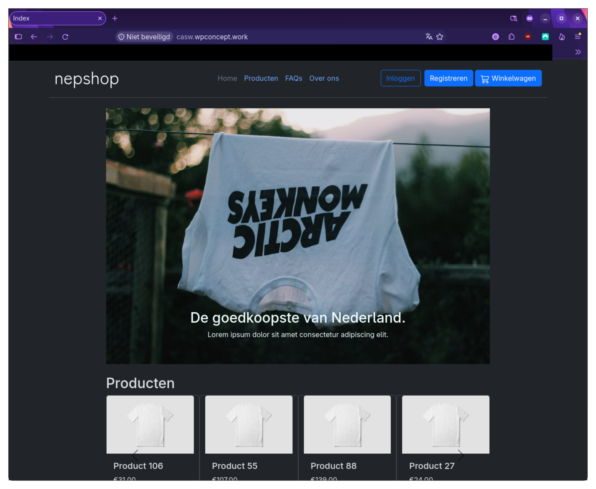
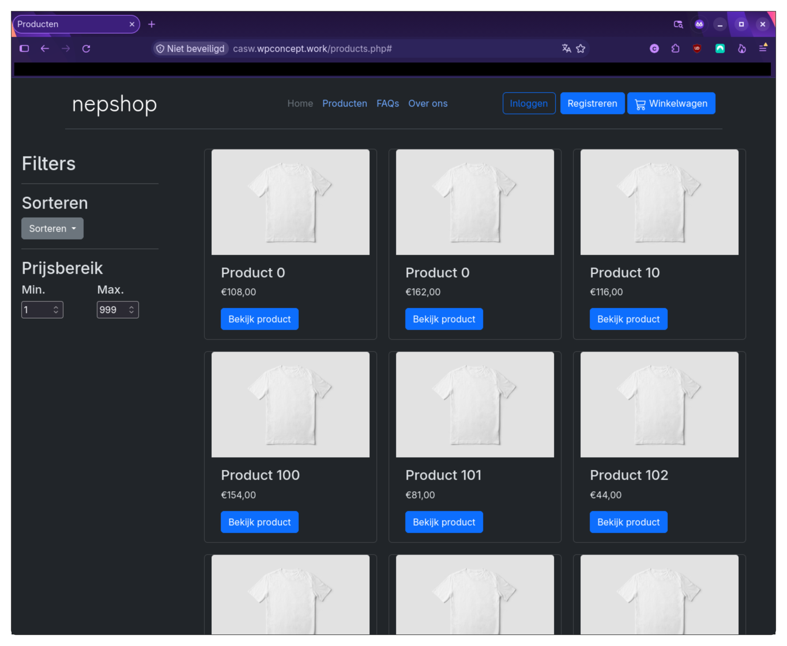
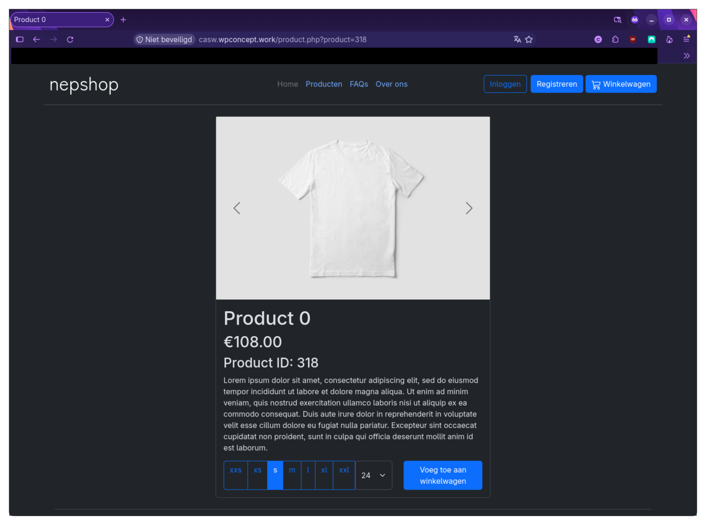
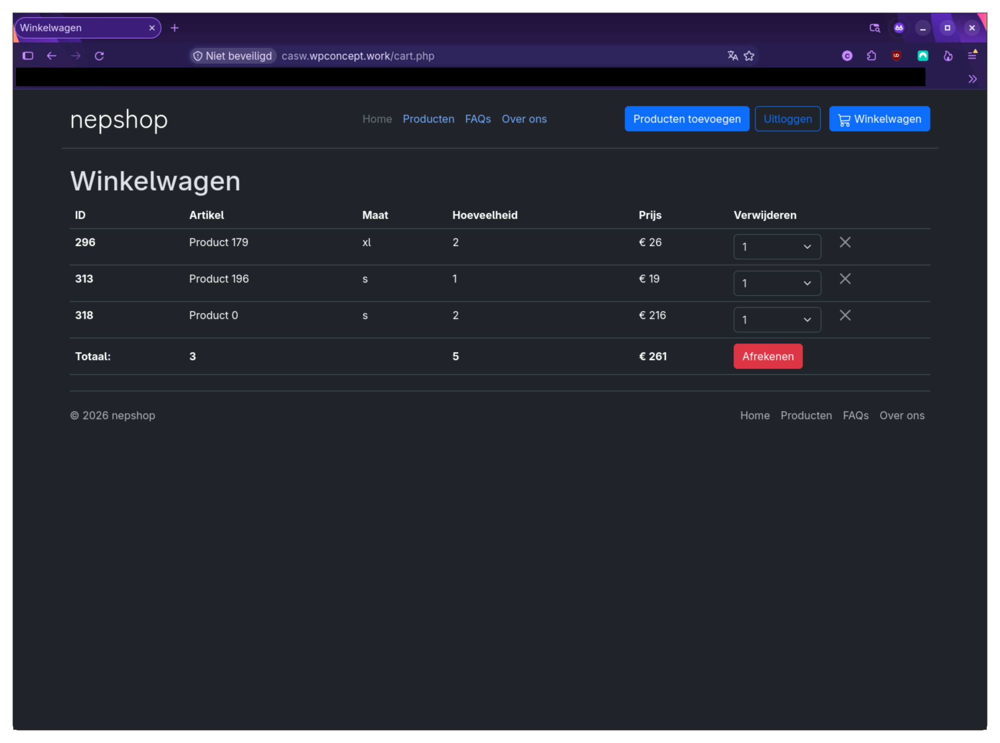
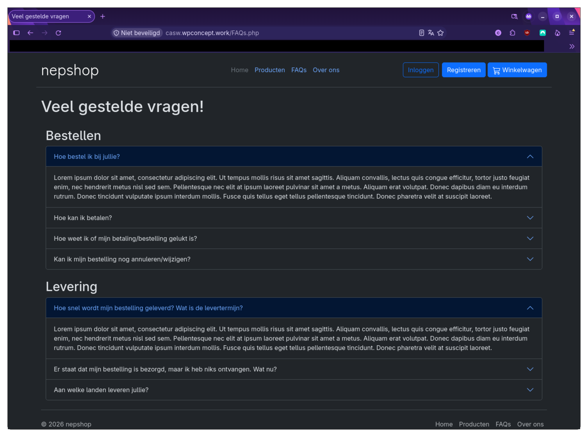

# nepshop
(Work in progress) a fictional webshop i created to practice javascript/PHP.
## Demo
<a href='https://casw.wpconcept.work/'>Click here to visit a live demo. (https://casw.wpconcept.work/)</a>

## Status 
### General
- Header and Footer ✔️
- Index ✔️
- FAQs ✔️
- About ✔️

### Products
- Products Page
    - Viewing products ✔️
    - Sorting products ✔️
    - Filtering products (by price) ✔️
    - Filter by type (t-shirt, jeans, etc.) ❌
- Product
    - See product ✔️
    - Add products to cart ✔️
    - Add multiple images of product ❌
    - Add sale to product ❌

### Cart
- View cart ✔️
- Edit cart ✔️
- Update cart based on stock ✔️

### Checkout 
- Order products ✔️
- Update stock ✔️
- add order to Database ✔️
- Change address of user ❌

### Accounts
- registering
    - Creating account ✔️
    - Autofill address ✔️
    - Form validation with alerts ✔️
    - Hashing password ✔️
    - Sending confirmation mail and asking to confirm ❌
- Log in
    - Form validation ✔️
    - log out ✔️
- Updating user profile
    - Change password ❌
    - Update address ❌
    - Remove account ❌
### Admin account
- Adding products ✔️
- Editing products ✔️
- Deleting products ✔️
- Viewing orders ✔️
- Editing orders ❌

## Screenshots

## Tech Stack
- PHP
- Javascript
- Bootstrap